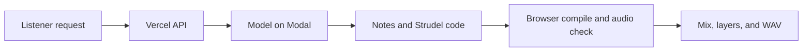
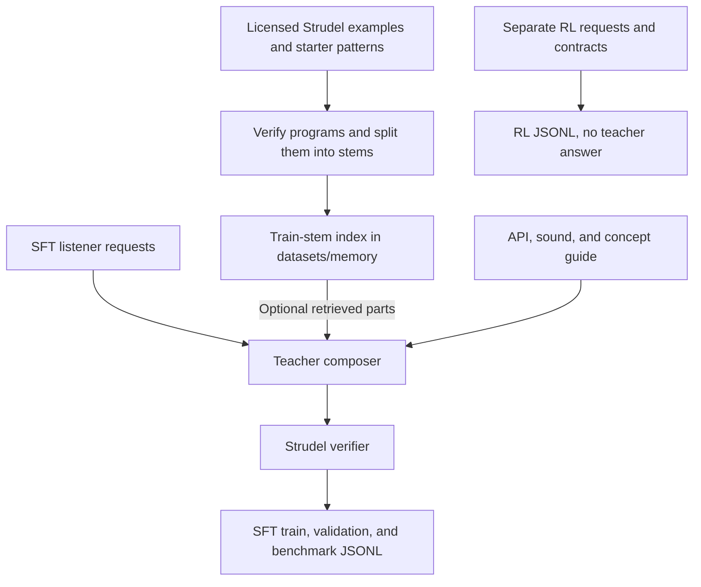
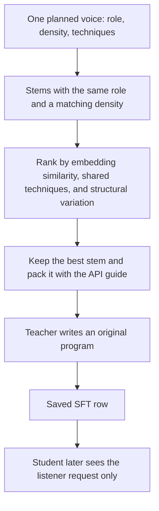
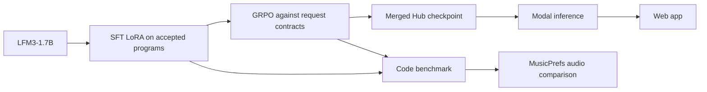

# TuneLM

[Repo](https://github.com/shanmukh05/TuneLM) · [Dataset](https://huggingface.co/datasets/tensorfiend/code2music) · [Model](https://huggingface.co/tensorfiend/TuneLM-LFM3-1.7B-code2music-2011) · [Try TuneLM](https://www.tensorwrites.com/tunelm) · [Blog](https://www.tensorwrites.com/posts/tunelm)

TuneLM turns a music description into executable [Strudel](https://strudel.cc/) code. Strudel is a JavaScript live-coding environment for music. The browser plays the program. You can edit the source to change the music, run it in Strudel, or export the rendered audio.

This repository contains the web app, the dataset generation pipeline, the optional reference library, the Strudel verifier, and the code for training and evaluating the model.

[Try TuneLM](https://www.tensorwrites.com/tunelm) · [View a Strudel example](examples/groove.js)

## Use the web app

1. Open **Try TuneLM** in the app. Enter a prompt such as “Make a 120 BPM groove in C minor with drums, bass, and soft chords.”
2. Read **Composition notes** to see how the model interpreted the request. Open **Code** to inspect or copy the program.
3. Open **Music** to play the full mix or an individual layer. Click or drag on the waveform timeline to change the playback position. Use **Download** to export a WAV file.

Keep the chat open to revise the composition with a follow-up prompt. The app compiles the generated code and checks that it produces audio before it shows the result. If a check fails, the app can ask the model to repair the code.



## Dataset

Teacher models write the supervised examples. Each example pairs a listener request with composition notes and a Strudel program. The models, fractions, and token budgets live in the generate config, such as `configs/samples-sft.yaml`. The verifier runs the program and checks for playable events and supported sounds before the pipeline accepts the example.

Reinforcement learning uses a separate set of requests. Each request includes a contract for the musical constraints it names, such as tempo, key, instruments, or “no drums.” The model generates its own answer during training. The pipeline stores training, validation, and benchmark records as JSON Lines. The repository includes [starter patterns](examples/seeds.jsonl). The [dataset guide](docs/usage.md#dataset-creation-in-plain-language) shows how to generate the training records.



SFT and RL requests are written independently. An RL prompt is not a copy of an accepted SFT row, and the GRPO prompt does not include the teacher’s reference context.

## Reference memory

`datasets/memory` is an optional reference library for the teacher that writes SFT answers. It is a search index over verified musical parts, called stems, taken from reviewed Strudel examples. The index is derived and gitignored. Rebuild it with `tunelm build-memory` after ingestion. It is not a training set, and the trained model does not read it.

**Why it exists.** A teacher asked only for “a 120 BPM groove in C minor” has to invent every drum pattern, bass line, and synth part from the API description. Real accepted stems show one way a part of that role and density has already been written, including the methods it uses and how active it is. Those examples are reference material. The packed context says so explicitly: examples, instruments, keys, and techniques are not requirements, and the teacher composes its own program. The verifier then accepts or rejects that program on its own.

**What stays out.** Only stems from the train family split are indexed. Validation and benchmark sources never enter retrieval, so a held-out piece cannot be copied into a training answer. Generation can also exclude families for a particular query.

**Who sees it.** With `references: optional` in the generate config, the teacher receives the API guide plus the retrieved stems, trimmed to `context_tokens`. With `references: api`, the teacher gets the guide only. With `references: none`, it gets neither. LFM training and live inference send the listener request only, plus the original code when the task is co-creation. The GPU host does not need `datasets/memory` to train those prompt-first rows. Each saved row still records `memory_version`, so a dataset can be tied back to the index that informed the teacher.



Ranking uses the same filters for both embedding modes: 0.65 embedding similarity, 0.25 overlap with the voice’s techniques, and 0.10 structural variation from the stem’s verifier telemetry. `tunelm build-memory` downloads the pinned semantic encoder on first use. `tunelm build-memory --lexical` builds an offline word-count index instead and never calls that model. The index is three files:

| File | Role |
| --- | --- |
| `metadata.json` | Schema, content hash, embedding settings, and the train stem IDs |
| `embeddings.npy` | One normalized vector per stem, in that ID order |
| `index.sqlite` | Role, density, and the stem record, opened read-only during generation |

Build the corpus first. `python scripts/collect_seeds.py --config configs/registry/sources.yaml --ingest` downloads the reviewed sources, verifies them, and writes accepted stems. `tunelm ingest examples/seeds.jsonl` rebuilds a corpus from the ten starter patterns only. Then run `tunelm build-memory`. Source selection and licenses are in the [source research](docs/source-research.md) notes.

## Training and evaluation

1. **Supervised fine-tuning (SFT).** We fine-tuned [LFM3-1.7B](https://huggingface.co/LiquidAI/LFM3-1.7B) with low-rank adaptation (LoRA). This stage teaches the model to write Strudel programs and describe its musical choices.
2. **Reinforcement learning (RL).** We continued from the fine-tuned model with Group Relative Policy Optimization (GRPO). The model generates several responses per prompt. Invalid programs receive zero reward. The [reward function](docs/rl-reward-design.md) scores valid programs on the request contract: the constraints the listener actually wrote, including rules such as “no drums.”



The repository provides two ways to evaluate a model. The [code benchmark](docs/usage.md#local-inference-and-symbolic-benchmark-evaluation) checks whether generated programs run and follow held-out requests. The [MusicPrefs evaluation](docs/audio-evaluation.md) renders those programs and compares the audio across models on the same 120 prompts.

## Run locally

Install Node.js 22 or later. Run these commands from the repository root.

```sh
npm ci
npm run dev:web
```

Open `http://127.0.0.1:4173/tunelm`. Play the example on the **Overview** tab to try playback. Live generation requires a running inference service.

Python 3.11 or later runs dataset generation, memory, training, and evaluation. From a virtual environment:

```sh
pip install -e '.[train,memory,teacher,dev]'
tunelm --help
```

The [usage guide](docs/usage.md) has the dataset, verification, and training commands. `memory` installs the semantic encoder used by `build-memory`. `teacher` installs the provider clients used to author prompts and SFT answers.

## Deployment

Vercel builds the web app with `npm run build:web` and serves it at `/tunelm`. The browser starts a composition job and polls for the result through the Vercel API. The API forwards these requests to Modal. Modal runs the model and returns the composition notes and Strudel code. The browser renders the audio.

Use the [Vercel configuration](vercel.json) for the app and API routes. Use the [Modal entry point](scripts/modal_inference.py) to deploy the inference service. The checkpoint and revision are set in [configs/inference.yaml](configs/inference.yaml).

```sh
modal deploy scripts/modal_inference.py
```

## Repository layout

| Path | Contents |
| --- | --- |
| [`web/`](web/) and [`api/`](api/) | Chat UI, browser audio playback, and the composition API |
| [`src/tunelm/`](src/tunelm/) | Python CLI, dataset generation, memory, training, and evaluation |
| [`verifier/`](verifier/) | Strudel syntax and execution checks |
| [`scripts/`](scripts/) | Modal inference and audio-evaluation helpers |
| [`configs/`](configs/) | Settings for dataset generation, training, inference, and evaluation |
| [`datasets/memory/`](datasets/README.md) | Rebuilt stem index: metadata, embeddings, and the SQLite lookup |
| [`docs/`](docs/) | Pipeline commands, data formats, and reward design |

The code uses the [AGPL-3.0-or-later license](LICENSE).
